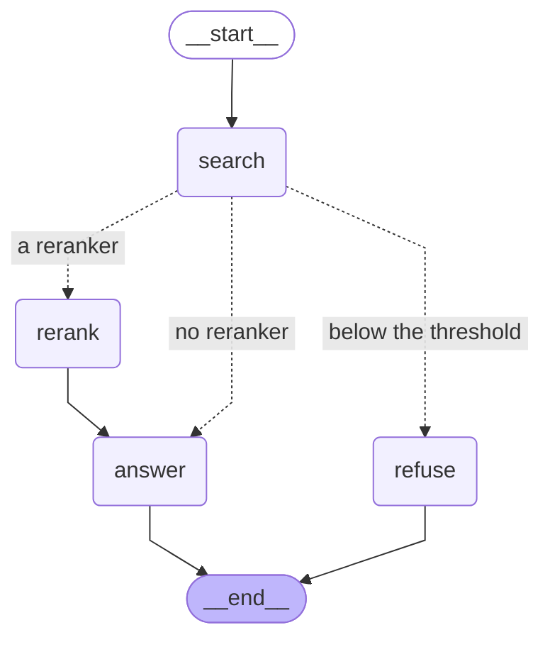
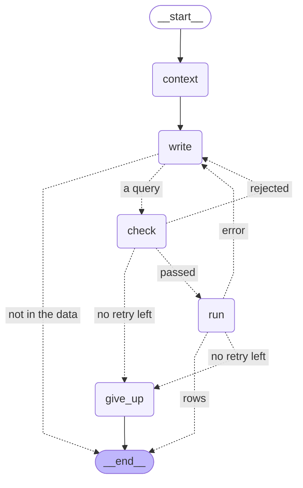

# llm-service

Python / FastAPI. Document ingestion, and `/query`: routing, answers from the documents, from the campaign data
(Text-to-SQL) or from both. Conversation memory and caching later.

## Running it locally

Python is pinned to **3.12** (see `.python-version`). [uv](https://docs.astral.sh/uv/) is recommended:

```bash
cd llm-service
uv python install 3.12
uv venv
uv pip install -r requirements.txt
uv run python -m app.server --reload
```

It refuses to start without `OPENAI_API_KEY`, `INTERNAL_SERVICE_TOKEN` and `SQL_READER_PASSWORD` in `.env`, instead of
failing on the first question; the reader's password also needs `scripts.enable_sql_reader` (docs/development.md). Use `python -m app.server`, not plain `uvicorn app.main:app`: see "The query path" below.

http://localhost:8000/health returning `{"status":"ok",...}` means it works.
http://localhost:8000/docs is the generated API documentation.

<details>
<summary>Without uv, using a standard venv</summary>

```bash
cd llm-service
py -3.12 -m venv .venv          # needs Python 3.12 installed first
.venv\Scripts\Activate.ps1      # WSL/macOS: source .venv/bin/activate
pip install --upgrade pip
pip install -r requirements.txt
python -m app.server --reload
```
</details>

## Layout

```
app/
├── server.py      how to start the API: chooses the event loop, then starts uvicorn
├── main.py        the FastAPI app: startup checks, the query flow built from the settings, error shape, /health
├── query_api.py   POST /query: internal token, request and response format, time limit, failures to status codes
├── query_flow.py  the top of a query: route, both paths at once, cancel the one ruled out, one answer
├── config.py      environment variables (the repository-root .env)
├── db.py          Postgres: sync connections for ingestion, async read-only pools for queries and for generated SQL
├── time_budget.py one time budget per message or query, shared by all its layers
├── consumers/     Kafka consumer (the document pipeline), a separate worker process
│   ├── upload_consumer.py   consume loop: manual commits + retries + dead-letter topic + graceful shutdown; entry point main()
│   ├── events.py            the Python half of the message contract (pydantic, mirrors Java's UploadEvent)
│   ├── storage.py           storageKey -> the real file in the upload folder (with path traversal defense)
│   ├── handlers.py          the ingestion pipeline: uploads status, parse, chunk, embed, store; idempotent
│   ├── data_tables.py       CSV uploads: validate every cell, then replace a campaign's rows in one transaction
│   └── errors.py            PermanentError: errors where retrying is pointless, straight to the dead-letter topic
├── rag/           parsing / chunking / embedding / retrieval / Q&A
│   ├── parsing/             Markdown / docx / PDF -> the same typed elements (headings, paragraphs, list items, tables)
│   ├── chunking.py          elements -> chunks: by section, token limit, contextual header, SOP steps
│   ├── document_fields.py   which values a documents row gets (the upload decides, the frontmatter fills gaps)
│   ├── embeddings.py        Embedder interface + OpenAI implementation + batching; which failures are worth retrying
│   ├── store.py             SQL for ingestion: uploads row, catalog labels, documents + doc_chunks
│   ├── retrieval.py         who may see what, and the search itself
│   ├── query_models.py      the async model calls of a query, with retries inside the budget
│   └── answering.py         the documents path, a state graph: search, threshold, rerank, answer, citation check
├── sql_agent/     Text-to-SQL
│   ├── schema.py            what a model is shown: views or tables, the data dictionary, the names in the data
│   ├── guard.py             the checks a generated query passes (sqlglot, allow-lists), the department filter, the row limit
│   ├── execute.py           one SELECT, read-only, with the asker's department set, time and row limits
│   ├── examples.py          the example questions closest to a question; examples.yaml holds them
│   ├── pipeline.py          the data path, a state graph: examples, write, check, run, retry with the error; then explain
│   └── campaigns.py         which campaign "the last one" is, among the asker's own, as sql_reader
├── router/        routing.py: which paths a question takes; rewriting.py: a question that stands on its own; periods.py: dates from today
└── memory/        Redis cache + conversation memory
evaluation/        the evaluation dataset's format (dataset.py), the review page (review.py), the runs (run.py for
                   documents, sql_run.py for SQL: the pipeline, or the baseline agent in sql_agent.py, route_run.py
                   for routing, flow_run.py for the whole query path); not part of the service
tests/             pytest; test_events (contract / cross-language drift) test_storage (path traversal)
                   test_upload_consumer (every branch of the consume loop) test_health
                   test_embeddings (fake OpenAI client) test_parsing (all three formats parse the same)
                   test_chunking (steps stay whole, sections stay apart, oversized units split with overlap)
                   test_data_tables (every refusal says what to fix and where)
                   test_retrieval (real Postgres: who sees what, the approximate index, the pool)
                   test_answering (fake models: refusals, citations, nothing held while waiting)
                   test_query_models (fake client: retries inside the budget, the limit on calls at once)
                   test_query_api (the real app with a fake service: who may call, failures, starting up)
                   test_query_flow (fake paths and router: what starts before the route, what it cancels, which
                   answer reaches the asker, nothing left running, what a rewrite restarts and asks back)
                   test_rewriting (fake model: which replies are taken, falling back to the question as asked; dates)
                   test_campaigns (real Postgres as sql_reader: the asker's own campaigns, asking back, each layer alone)
                   test_ingestion (real Postgres: idempotency, rollback, replacements, conflicts, for documents and tables)
                   test_generate_corpus (the corpus generator without a model: numbers, the rules of a draft, authors)
                   test_dataset (the dataset's format, the split, finding a labelled section)
                   test_generate_questions (the question generator without a model: tasks, which answers are kept, SQL)
                   test_review (the review page's API: what can change, what is checked, what is exported)
                   test_sql_agent (real Postgres: the metric views, what a model is shown, running a generated
                   query, the baseline agent with a fake model, what a run scores)
                   test_sql_pipeline (the checks and their attacks; real Postgres: the department filter, the
                   examples, the pipeline with fake models, what a pipeline run scores)
tests/fixtures/documents/   docx / PDF fixtures, generated from Markdown by scripts/make_sample_documents.py
```

## Document parsing

`app.rag.parsing.parse_file(path)` picks a parser by extension (`.md` / `.docx` / `.pdf`) and returns a
sequence of elements: kind (heading / paragraph / list item / table), level, heading path, and for PDFs the
page number. Chunking works only with these elements and doesn't care about the original format.

- **Markdown** (markdown-it-py), **docx** (python-docx): the formats carry their structure, it is read directly
- **PDF** (pdfplumber): only "what was drawn where, at which size"; structure is inferred from font size,
  indentation and line spacing, and spaces from the gaps between letters. Only digital PDFs with a text
  layer are supported; scans are rejected (they need OCR)
- broken file, unsupported format, wrong encoding, PDF without a text layer → `DocumentParseError`; retrying won't help

After changing a sample Markdown file, regenerate the docx / PDF (needs Windows + Word or WPS):

```bash
uv run python -m scripts.make_sample_documents
```

## Chunking

`app.rag.chunking.chunk_document(parsed, info)` turns the elements into chunks:

- **one section at a time**: a chunk never crosses a heading. A section's elements are packed in order up
  to 600 tokens; a step (top-level numbered list item) and its nested items are never split. Every sample
  SOP section fits into one chunk (a whole procedure is 233-303 tokens with its header), so "how do I handle X" retrieves
  the whole procedure
- **only a unit larger than the limit on its own is cut further**: a table by rows, repeating the header
  row; text by LangChain's `RecursiveCharacterTextSplitter`, overlapping by whole sentences (up to 80 tokens)
- **a contextual header** on every chunk, embedded and stored with the text:
  ```
  SOP | All departments
  Account Restriction Handling > Procedure

  1. Identify the rule and the account: ...
  ```
  The labels come from `catalog_entry()` (`db/migration/V5`), the function behind the `document_catalog` view
- list numbers are written back (`3. Collect appeal evidence`), since docx and PDF don't store them as text
- `sop_steps(parsed)` gives the `documents.steps` value; `document_fields(...)` decides title / department /
  category / responsible_team (title and department always come from the upload, never from the file)

Lengths are tokens of the embedding model's tokenizer (`tiktoken`, `cl100k_base`). **tiktoken downloads its
1.7 MB encoding file on first use** and caches it, so the first test run needs the network; a deployment
image should download it at build time (set `TIKTOKEN_CACHE_DIR` and call `tiktoken.get_encoding` once).

## Running the consumer

```bash
uv run python -m app.consumers.upload_consumer
```

**It is a process separate from FastAPI** (`python -m app.server` is the other one). Prerequisites: Kafka
running and the topics created (`init_topics`, which includes the dead-letter topic
`document-upload-events.dlq`), Postgres migrated, and `OPENAI_API_KEY` in `.env` (checked at startup). The
startup log prints the resolved `upload_dir`: mismatched upload folders (the two services pointing at
different directories) is the most common deployment problem.

What it does with each upload (`app/consumers/handlers.py`, reasons in [docs/architecture.md](../docs/architecture.md)):
1. **short transaction**: lock the `uploads` row (written by the backend before publishing); already `done` →
   duplicate, skipped; otherwise → `processing`
2. **no transaction**: read the file, parse, decide the fields, chunk, embed in batches
3. **short transaction**: lock the row again (a duplicate may have finished meanwhile), insert or replace the
   document, rebuild its chunks, set the campaign flag, mark the upload `done`

The log shows every step:
```
upload_id=d16352d3-... processing: document sop, department=ALL, file=d16352d3-...-account-restriction-handling.md
upload_id=d16352d3-... parsed 17 elements into 3 chunks (428 tokens)
upload_id=d16352d3-... embedded 3 chunks with text-embedding-3-small: 428 tokens billed, 1.62 s
upload_id=d16352d3-... done: doc_id=3 (new, 'Account Restriction Handling') with 3 chunks in 1.87 s
```
Measured: 0.7-1.9 s per sample document, almost all of it the embedding call (the first message also loads
the tokenizer).

**Time limit.** Kafka's `max.poll.interval.ms` (5 minutes) is the longest a consumer may go between two polls
before it is removed from the group. One message is handled between two polls, so it has to stay below that
even when everything goes wrong, and the normal case says nothing about the worst one: with a hanging or
rate-limited embedding API, retries in several layers used to add up to about 590 s (every request timing out)
or 30 minutes (429 with `Retry-After: 120`). So one message gets **one time budget** (200 s,
`doc_consumer_message_budget_seconds`), shared by all its attempts:
- the embedder does its own retries (the OpenAI SDK's are off) and caps every request timeout and every wait,
  including `Retry-After`, by the time left; if a wait doesn't fit, it gives up at once
- the consumer starts another attempt only if the backoff fits; when the budget is gone, the message is dead-lettered
- database waits are bounded too (`connect_timeout`, `statement_timeout`, `lock_timeout`). A data table loads with
  one `COPY`, so `statement_timeout` limits the whole load (worst case in [docs/architecture.md](../docs/architecture.md))
- at startup the consumer refuses settings where the budget plus 60 s (dead-letter write, commit) doesn't fit
  `max.poll.interval.ms`
- if the limit is passed anyway, the late commit fails with `UNKNOWN_MEMBER_ID`. That is logged and the loop goes
  on: the message is delivered again and idempotency handles the second copy

Behavior (design reasons in [docs/architecture.md](../docs/architecture.md)):
- **at least once**: auto-commit off; the offset is committed only after processing (or once the message is safely dead-lettered)
- broken message (not JSON / breaks the contract / path outside the upload folder), unparseable file, a CSV that fails
  validation, no uploads row, a conflicting or stale document or table → no retry, straight to the dead-letter topic
  `document-upload-events.dlq`
- any other exception → exponential backoff (at most 3 attempts = first try + 2 retries, waiting 0.5 s, 1 s, while the message's time budget lasts), then the dead-letter topic; dead letters carry the failure reason, attempt count and source offset
- dead-letter write fails → no commit, and the process crashes (better to stop than to lose a message)
- once a message is dead-lettered, its upload is marked `failed` with the reason
- each delivery is counted in `uploads.delivery_count` before any work: the retries above live in memory and start over if the process dies, so a file that kills the process would otherwise come back forever. After 3 deliveries that didn't finish, the next one is dead-lettered (`doc_consumer_max_deliveries`). The count starts over on `done` or `failed`, so a replay from the dead-letter topic isn't refused
- after being killed hard, a restarted consumer waits for the old member's **session timeout** (about 45 seconds) before taking over the partitions; a graceful Ctrl+C hands over immediately

To check the consumer without the Java backend: `uv run python -m scripts.kafka_producer_test`
(writes a file into the upload folder, records the upload, and publishes a contract-compliant event; it
creates a real "Kafka smoke test" SOP each time, see the script's docstring for how to remove them).

## The query path

`POST /query` is only for the backend. It takes the question plus the user's id, role and department, and those are
trusted, so every call must carry `X-Internal-Token` and the port must not be reachable from anywhere else. It listens
on 127.0.0.1 unless `LLM_SERVICE_HOST` says otherwise. Examples of the format: `contracts/query.examples.json`.

`app/query_flow.py` runs a question:

```
question --+-- route: one model call, 2 s at most ----------------------------------+
           +-- rewrite: one model call, 2 s at most                                 |
           +-- embed --+-- documents graph: search -> rerank -> answer             | the route cancels the
                       +-- data graph: context -> write -> check -> run (retry)     | path it rules out
rewritten: the paths stop; the campaign is found or asked back; they start again on the question filled in
then by the route:  documents -> the documents' answer
                    data      -> the rows explained
                    both      -> one answer written from the excerpts and the rows together
```

**The rewrite** (`app/router/rewriting.py`). One model call with structured output, beside the router: a follow-up gets
what "it" or "the Beauty one" refers to from the turns before it, and a campaign or a time named relative to now becomes
a placeholder, `{campaign}` or `{period}`, with what kind of reference it is. Code fills them in. The campaign is found
by `app/sql_agent/campaigns.py`: the asker's finished campaigns, latest end date first, narrowed by every word of its
kind ("Black Friday"), run as `sql_reader` under row-level security with the department in the WHERE clause as well.
The dates are worked out from today (`app/router/periods.py`). The question goes on as asked when the model doesn't
reply within `REWRITE_TIMEOUT_SECONDS` (2 s), fails, or replies with placeholders and references that don't agree.

- **Asked back**, `status: clarify` with `candidates`: an executive or admin asking about a kind of campaign more than
  one department ran ("the last Black Friday"), or two campaigns at the place asked for that ended on the same day.
- **Nothing found**: one fixed sentence, the same for another department's campaign and for one that doesn't exist.
- **The basis**: an answer about a campaign found this way opens with it ("Based on Beauty Black Friday Live, which ran
  from 2025-11-18 to 2025-12-14.") and carries it as `basis`. When the documents were searched and it has no review
  yet, the line says so and names the latest before it that has one.
- `/query` has no conversation memory yet, so it gives the rewrite no turns; the evaluation passes a follow-up's own.
- On dev ("With the rewrite" and "Tuning the rewrite's instructions" in [docs/eval-report.md](../docs/eval-report.md)):
  14 of 108 rewritten, 5 of the 6 follow-ups among them (the first instructions wrote out 2), at p50 3.7 s as the paths
  start again; the questions left as asked took as long as before there was a rewrite. "The previous batch" and a
  campaign named by its date stay as asked.
- `evaluation/rewrite_run.py` runs the rewrite alone, to try its instructions for a fraction of a full run.

**Both paths start before the route is known.** Routing is a model call, p50 1.2 s and p95 1.5 to 1.7 s on a development
machine, and waiting for it would put a question about data at about 3.8 s, estimated from each step's measured time,
against the 3 s target. So the documents' answer and the data path's first query are written while the router decides,
and the path it rules out is cancelled: its model call stops, and a query already running in Postgres is cancelled on the
server, with its connection back in the pool and working (measured: 5 ms, `test_sql_pipeline.py`). The price is the model
calls thrown away: a query being written for a question about documents, and a documents' answer for a question that
gets one answer from both.

**Why the top isn't a LangGraph graph.** LangGraph runs a graph in steps, and the branches of a step all wait for the
slowest before any goes on. Measured with sleeps standing in for the calls: a 0.5 s chain of three nodes beside a 1 s
router finished at 1.47 s; the same chain as one subgraph node, at 0.53 s. And a running branch can't be stopped from
inside the graph, so a question about documents would wait for the data path's query and its retries. So asyncio starts
the two paths, cancels one and joins the rest, and each path is a state graph of its own. They cost, measured on a
development machine: about 17 MB more per process to import LangGraph, and 0.35 ms plus 0.33 ms a step of CPU per run,
about 3 ms a question for the two graphs. Little against 3 s, but CPU is what limits a process (below).

**A question for both.** With excerpts and rows, one model call writes the answer from the two together, citing the
excerpts as a documents answer does; its numbers come from the rows, which the asker gets with it, so an answer that
cites no excerpt still stands. Answering from each and merging the answers would be a model call more, about a second,
and the merge could drop citations. With rows and no excerpts the rows are explained; with no rows, the documents' answer
is used. How hard the model reasons for it is `COMPOSE_REASONING_EFFORT`, none until the evaluation grades these answers.

**What it returns.** The answer; `status`: answered, refused, or failed when no query that answers it could be written;
the citations; the departments searched; the `paths` that ran; and `data`, the query an answer rests on with every row,
each value as text so amounts stay exact.

**Errors.** A path that was needed and failed fails the query, as either path alone did; one the route ruled out may
fail unheard. Whatever happens, every task a question started is cancelled and waited for before it returns.

The two graphs, as LangGraph draws them (`graph.get_graph().draw_mermaid()`; `test_query_flow.py` checks they match the
code). The documents path:



The data path (`SQL_RETRIES` is 2; after the last failure it gives up):



### The documents path

```
role + department -> which departments may be searched (an unknown role is an error, never an unfiltered search)
question          -> embedding
embedding         -> search among those departments, top 50   <- the only step that holds a database connection
best score < 0.14 -> refuse, without calling the model or the reranker
50 candidates     -> reranker (bge-reranker-v2-m3 in TEI), 0.5 s at most; on a timeout or an error, vector order
first 5 of them   -> the prompt
excerpts          -> model -> the fixed word NOT_IN_DOCUMENTS, or a reply citing nothing -> refuse
                           -> an answer -> every [n] must be a real excerpt; otherwise 502
```

**Reranking.** Vector search compares a question's vector with each chunk's; a cross-encoder reads the question and a
chunk together and tells much better which chunk answers. The search returns 50 candidates, `bge-reranker-v2-m3` orders
them, and the prompt takes the first 5. It runs in Text Embeddings Inference, a separate server (`docker compose
--profile rerank up -d reranker` locally, a GPU in production), and llm-service sends it one HTTP request per query
(`app/rag/reranking.py`): in this process it would load 1.9 GB per worker and its computing would stop the event loop.
It only gets what the department-filtered search returned. The threshold still looks at the best vector similarity.
A timeout, an error, or an answer that doesn't rank every text once is logged and the query goes on in vector order,
so a reranker that is down makes answers worse, never absent. On a development CPU it takes about 40 s for 50
candidates and always falls back; on Windows even a reranker that isn't running shows up as a timeout, because a
refused connection there takes about 2 s to fail. Its latency on a GPU isn't measured yet (#11). What it gains:
[docs/eval-report.md](../docs/eval-report.md). `RERANKER_URL=` (empty) turns it off.

**Async from the start.** Sync FastAPI endpoints get 40 worker threads, far below the 900 queries in flight the system
is designed for. The price: one blocking call in an async function stops every query in the process, so no sync SDK and
no `time.sleep` on this path. Ingestion stays sync: a consumer handles one message at a time.

**Starting it.** Async psycopg can't run on `ProactorEventLoop`, the default on Windows, and uvicorn only switches away
from it when reloading. Measured: `uvicorn` with `--reload` connects to the database and without it doesn't, a
difference that hides until the first run without reload. `python -m app.server` chooses the event loop first, with or
without `--reload`, and plain `uvicorn` on Windows now fails at startup with a message saying so.

It starts one process. **Production runs `python -m app.server --workers 4`** (or `LLM_SERVICE_WORKERS=4`), for the reason
under "How much one process can do" below. The workers share the port. A worker that dies is replaced: with one killed
at 100 QPS, 10 of 1,200 queries failed, the others didn't slow down, and uvicorn started a new one. `--reload` ignores
`--workers`.

Logging is configured through uvicorn, which applies it in every process; `logging.basicConfig` would reach only the
parent, and with 2 workers not one query was logged. An idle connection stays open 35 s, longer than the 30 s the
backend's HTTP client keeps one. With uvicorn's default of 5 s, a query sent just as the server closed its connection got
a `503`: 1 of 1,200 with bursts 4.95 s apart, and none of 800 with bursts 2 s apart.

**Time limit.** One query gets 12 s. `asyncio.timeout` is the hard stop and cancels whatever is running; measured with
a model that hangs and a 3 s budget, the answer came after 3.03 s. `TimeBudget` lets the layers decide earlier, so a
retry that can't fit gives up with the real reason. The SDK's retries are off. The backend's timeouts sit above this (1 s
to connect, 14 s to read), so a client waits about 15 s at the very worst, and normally gets llm-service's own 504.

**Refusing.** The model does nearly all of it. On the evaluation's dev questions, the ones to refuse scored 0.33 to 0.65
and the answerable ones 0.27 to 0.70, so similarity can't tell them apart and no threshold below the answerable ones
stops a wrong answer; the model refused every question to refuse. The threshold, 0.14, only saves a model call on
questions far from everything (unrelated probes scored 0.10 to 0.25) and stays clear of answerable questions. Why 0.14
and not higher: [docs/eval-report.md](../docs/eval-report.md). A refusal reads the same whether a document exists in
another department or not.

**Citations.** The check proves each link is real, not that each sentence is supported by what it links to; the
evaluation grades that offline. An answer citing an excerpt that doesn't exist is an error rather than a retry. A reply
citing nothing at all is shown as a refusal and logged: measured, all 6 errors in 540 evaluation queries were the model
refusing in its own words instead of with the fixed word, and each would have been a 502.

**Measured latency** (a few requests on a development machine, not a load test): embedding 0.15 to 0.7 s, search 0.2 ms on
the server, model 1.3 to 3.1 s with one at 8 s. So a full answer takes about 2 to 3.4 s and **doesn't always meet the 3 s
target**. With routing, through the backend, 6 questions (documents, data, both, another department's data, an
executive's, one nothing answers) took 2.0 to 3.7 s; the first after starting took 4.7 s, because setting up the first
connections made the router miss its 2 s and the keyword rule decided. On all 108 dev questions, in-process: p50 1.6 s
for the documents, 2.7 s for the data, and 4.5 s for the 12 that need both, none of those under 3 s, because the answer
written from both takes about as long again as the paths ("The whole query path" in
[docs/eval-report.md](../docs/eval-report.md)). On Windows each search also costs about 44 ms in Docker Desktop's port forwarding: the 19 KB vector takes 44 ms
through it and 0.2 ms inside the container, so that part is specific to this setup.

**The limit on model calls.** `ModelCallLimit` is an `asyncio.Semaphore`, one per process, shared by embeddings and answers.
`MODEL_MAX_CONCURRENT_CALLS` (default 300) sets its size in each process, so 4 processes allow 1,200 against the 900 of the
peak. An exact share is too tight, because workers on one port don't get equal work: at 300 QPS, 225 each refused 53 of
1,500 queries and 300 each refused none. Development can set a low value in `.env`, which says nothing about production.
The rate limit in the backend controls how many queries come in; this protects against what that can't see: at 6 s per
answer, 300 queries a second would become 1,800 calls at once. A query waits up to `MODEL_SLOT_WAIT_SECONDS` (default 1 s)
and never past its budget, then gets `503` with `Retry-After`, so nobody queues until their time runs out. Measured with a model that hangs, 2 slots and 10 queries:
the model saw at most 2 calls, 8 queries got the `503` in about 1.1 s, and the other 2 got the `504` at 12 s. A slot is held
only during the request itself, not while waiting to retry, or a rate-limited provider would use up every slot with queries
that are only sleeping. The SDK's own limits follow this setting, because its default of 1,000 connections, 100 kept
alive, would be a hidden limit below the 500 QPS target. These numbers were measured before routing, when a query made
one model call at a time. A routed query holds up to four at once while the router decides (the router, the rewrite, the
documents' answer and the query being written), so the same peak needs more slots; how many hasn't been measured (#11).

**How much one process can do** (real code and real Postgres in a Linux container with 12 CPUs, a stub model taking 2.9 s,
5 to 10 s of load, every query answered and none refused. Not the load test of #11, and the backend isn't in it):

| Processes | QPS | p50 | p95 | Slowest | Most calls at once |
|---|---|---|---|---|---|
| 1 | 100 | 2.97 s | 3.11 s | 3.14 s | 300 |
| 1 | 140 | 3.41 s | 4.74 s | 4.89 s | 356 |
| 1 | 300 | 8.27 s | 12.96 s | 13.50 s | 355 |
| 2 (round robin on two ports) | 300 | 4.20 s | 6.42 s | 6.66 s | 644 |
| 4 workers | 300 | 3.02 s | 3.10 s | 3.30 s | 929 |
| 6 workers | 500 | 3.16 s | 4.16 s | 4.45 s | 1,480 |
| 8 workers | 500 | 3.12 s | 3.38 s | 3.58 s | 1,486 |

So one process reaches about 100 QPS: past that, the limit is one CPU core, not the slots. 3 processes weren't run.
This was the documents path alone. A routed query does more in a process (the router, the two graphs, the data path's
reads and query), so these numbers don't carry over to it, and it hasn't been measured (#11).

**Database connections.** Each process has its own pool, and Postgres allows 100 connections, shared with the backend and
the consumers, so `QUERY_POOL_SIZE` is 5. A connection is held only for the search: at 300 QPS at most 3 statements ran at
once. 5 each was as fast as 20 each, and at 20 each, 8 workers reached 99 connections and Postgres refused 30 attempts. At
5 each they reached 50, the backend's 10 included, with none refused. The search in these numbers is on Docker's internal
network. Through Docker Desktop's port forwarding on Windows, at 44 ms each, 5 connections do about 110 searches a second.

**On Windows, keep each process below about 250 queries at once.** Async psycopg needs the selector event loop, and
`select()` there watches at most 512 sockets, while each query uses about two. Measured with one process at 300 QPS:
`too many file descriptors in select()` stopped the event loop, and the process stayed alive but stopped answering, even
`/health`. It takes a restart, and uvicorn doesn't notice. Through the real backend with 4 workers, 150 QPS gave a p50 of
3.49 s, slowest 4.43 s; at 300 QPS one worker hit the limit and 214 of 900 queries got a `504`. Linux doesn't have this
limit, so load tests belong there. The whole chain at 300 QPS hasn't been run yet: that is #11.

**Not built yet:** the cache, conversation memory (so `/query` has no turns before a question to give the rewrite) and the
audit table.

## Creating the Kafka topics

```bash
uv run python -m scripts.init_topics
```

Idempotent: existing topics are skipped. Every topic the project needs is listed in the script's `TOPICS`;
on a new machine or after `docker compose down -v`, run it once instead of typing `kafka-topics.sh` by hand.

## Mock data

```bash
uv run python -m scripts.generate_mock_data
```

Reproducible: `random` and Faker are seeded and every date is computed from a fixed `AS_OF` date, so every
run produces the same rows (the campaign documents in `campaign_docs/` quote them). It empties and refills
the business tables, and through the foreign keys also uploads / documents / chunks. A campaign that is still
running has no product or customer rows: its export doesn't exist yet, so uploading one is a real `mode=new`
(`data_tables/` has samples for campaign 11).

## The evaluation corpus

```bash
uv run python -m scripts.generate_corpus --report   # who wrote what, and how long the paragraphs are
uv run python -m scripts.ingest_corpus              # upload all of it through the API
```

`sop_docs/` and `campaign_docs/` hold 85 documents: 30 SOPs, and 27 plans and 28 reviews of 30 campaigns. Seven
were written by hand; `scripts/generate_corpus.py` generated the rest from `scripts/corpus_spec.py`, and they are
committed because a model writes different text every time. Running it again writes only what is missing. It is the
corpus retrieval is measured on, so it is built to be hard: the same SOP in every department, campaigns of the same
name, a rule and its exception, campaigns with only one of their two documents (the folders' READMEs list them).

- **The numbers can't drift from SQL.** Every table and figure of a campaign document is rendered from the
  database and put into the model's text at a placeholder. A draft that uses a number not in its facts is
  rejected and written again, at most 3 times; so is one that writes a table out itself, which models asked to
  try again did in the first batch. An SOP may only contain the numbers of its brief.
- **Different authors.** A first batch written to one template came out with every paragraph about the same
  length. Each document now has an author with its own sections, length and habits: five for SOPs, three for
  plans, four for reviews. Across the 85 documents, paragraphs run from 1 word to 165 (median 25); 19 documents
  have a paragraph of 100 words or more and 49 one of 20 or fewer.
- **What the checks can't see.** They check numbers, not claims: a sentence like "every product's return rate
  was above 10%" passes because 10% is in the facts, true or not. That is for the human review of the dataset.
- **Ingestion goes through the API**, as the uploads of real people would: a staff member of the department
  uploads each document, and a company-wide one waits for that person's manager, who approves it. Measured on a
  freshly generated database: all 85 done, 10 of them approved, in 35 s; 347 chunks, 3 to 9 per document. Each
  department's staff can search 107 to 127 chunks, far more than the 5 a query returns.
- **Cost.** Generating the 78 documents cost about $0.03 with gpt-6-luna, retries included; embedding the
  corpus, about 51,000 tokens, about $0.001.

Nine generated SOPs use lettered sub-steps (a, b, c), which Markdown doesn't treat as a list, so they become
part of their step's text rather than `substeps`. The step stays whole either way.

## The evaluation dataset

```bash
uv run python -m scripts.generate_questions --report   # what the candidates cover
```

[eval/](../eval/) holds the dataset: 257 reviewed questions in `dev.jsonl` and `test.jsonl`, from 256 candidates
written by `scripts/generate_questions.py` with gpt-6-sol rather than the model that answers, and questions written by
hand. `uv run python -m evaluation.review` opens a local page to review them (127.0.0.1:8765). Every label names a section by its document and heading path, so
it survives a new ingestion; `evaluation.dataset.resolve()` finds the chunks. A question is only kept when its
answer points' numbers are in the sections it cites, its SQL runs read-only and keeps to the asker's department,
and an unauthorized question really is about something its asker can't see. The format, the split and the
numbers: [eval/README.md](../eval/README.md).

```bash
uv run python -m evaluation.run --split dev --name baseline   # one evaluation run: needs Postgres with the corpus
```

`evaluation/run.py` sends every question through the same `QueryService` as `/query` and writes retrieval (Recall@5,
Recall@50, MRR by kind of question), graded answers, the refusal threshold sweep, latency and cost to
`eval/results/`. Answers are graded by `evaluation/judge.py` the way RAGAS does it, without RAGAS, which can't be
installed next to openai 3.29. Results and what they mean: [docs/eval-report.md](../docs/eval-report.md).

## Text-to-SQL: the pipeline

```bash
uv run python -m scripts.load_sql_examples   # the example questions, with their embeddings; after editing examples.yaml
uv run python -m scripts.enable_sql_reader   # once: sql_reader's login, with SQL_READER_PASSWORD in .env
uv run python -m evaluation.sql_run --split dev --name pipeline --pipeline --dictionary --views --examples 3 --retries 2
```

`app/sql_agent/pipeline.py` answers a question about the campaign data in fixed steps, the data path of `/query`.
Steps 1 to 5 are a LangGraph state graph (drawn under "The query path"), so the retry is a loop with a bound that can be
seen; step 6 is apart, because a question for both gets one answer from the excerpts and the rows instead:

1. **Context.** The five metric views with their comments, the names in the data (the asker's department's only) and
   the 3 example questions closest to the question, among the asker's department's and those for every department. The
   views' description is read once per process; the names and examples on every question, while one connection is held.
   These reads are fixed SQL with bound parameters and run as `ops`, like the rest of the query path.
2. **Write.** One model call (`SQL_MODEL`, apart from the model that explains) writes one query, or the fixed word
   `NOT_IN_DATA` when nothing listed holds what the question is about, or, for staff and managers, when it asks only
   about another department. A question comparing theirs with others gets a query for their own numbers; one asking
   why or what to change still gets a query: the numbers about what it names. The prompt ends with the question to write the query for: ending it
   with "Question: ..." after the examples, the model once replied with its query and two more made-up examples.
3. **Check** (`guard.py`): one SELECT, only the views, allow-listed functions and plain casts, and for staff and
   managers every view becomes a subquery holding only their department's rows. The outer query gets `LIMIT 201`
   unless its own is smaller. What runs is regenerated from the checked tree. Why each rule: "Filtering data" in
   [docs/permission-model.md](../docs/permission-model.md).
4. **Run** as `sql_reader` (`db.sql_pool`), which can read only the views, under row-level security, in a read-only
   transaction that sets the department (`app.department`, or `app.all_departments` for executives and admins), at
   most 5 s (or what is left of the budget) and 200 rows kept.
5. **Retry.** A query that is refused or fails in the database goes back to the model with every failure so far, at
   most `SQL_RETRIES` (2) times. Only errors in the query itself: the database unreachable is not the query's fault.
6. **Explain.** A second model call words the result in a few sentences; the asker also gets the query and its rows,
   which are what the answer rests on. A result with no rows gets a fixed sentence and no model, so it reads the same
   whether another department has such data or nothing does.

The query path's budget bounds it all: 1 embedding, at most 3 queries written and run, 1 explanation. On dev: 2 model
calls a question, p50 2.4 s, about $0.0003 a question (numbers: [docs/eval-report.md](../docs/eval-report.md)).

## Routing

```bash
uv run python -m evaluation.route_run --split dev --name 1   # every way of routing on dev, about $0.007
```

`app/router/routing.py` decides which paths a question takes (`app/query_flow.py` runs it). One model call
(`ROUTER_MODEL`, no reasoning) with a reply of a fixed shape, a Pydantic model the provider holds the reply to
(structured output): the route (documents, data, both or none), how sure, and why. Both paths run below
`ROUTER_MIN_CONFIDENCE` (0.95); `none` still runs the document path, whose threshold and model decide whether to refuse,
so the router never refuses on its own. If the model doesn't reply within `ROUTER_TIMEOUT_SECONDS` (2 s), fails or
replies out of shape, a keyword rule decides. The router sees the question alone: which source answers it doesn't
depend on who asks. The structured call (`OpenAIStructuredModel` in `app/rag/query_models.py`) is shared, for
anything else code has to read from a model.

`evaluation/route_run.py` runs the keyword rule, a vote of the 5 nearest questions by embedding, the model and a
cascade on the same questions, and counts a path missing apart from a path extra. Results: "Routing" in
[docs/eval-report.md](../docs/eval-report.md).

## Text-to-SQL: the ablation and the leak check

```bash
uv run python -m evaluation.sql_ablation --split dev   # the table, from the runs below; no model calls
uv run python -m evaluation.sql_leak --name 1          # eval/unauthorized-sql.jsonl, about $0.006
```

`evaluation/sql_ablation.py` reads what each part of the pipeline is worth from `sql_run` result files, two runs of each
configuration: adding one part at a time (zero-shot on the tables, the data dictionary, the views, 3 examples, 2
retries), and taking one part out of the full pipeline. Its docstring lists each configuration's flags. A step is
credited with a question only when both runs agree on both sides of it.

`evaluation/sql_leak.py` asks 20 questions written to get another department's data, as staff and managers, through the
query path's pipeline as `sql_reader`, and 3 control questions as an executive or admin. `--questions dev` asks the
10 of `eval/unauthorized-sql-dev.jsonl` instead, the ones rules are worked out on. It also counts the questions about
another department alone that got the asker's own rows, which an explanation can put under the other department's
name. A leak is a value only another
department has (a campaign, host or product name, or an amount of $1,000 or more) in the rows or the answer. The
controls have to show other departments, so the check is known to find them. Nothing is tuned on these questions.

## Text-to-SQL: the baseline

```bash
uv run python -m evaluation.sql_run --split dev --name zero-shot-agent   # needs Postgres with the mock data and V9
```

The questions with a gold SQL go to a LangChain agent (`create_agent`, on LangGraph) with three tools: list the
tables, show their columns, run a query. They do what the tools of LangChain's SQL agent do, written here because
those are in `langchain-community`, which LangChain stopped maintaining in May 2026 and which needs a newer
pydantic-settings than this service pins; its schema tool also shows the model three rows of every table, IP
addresses included. Measured: `langchain` and `langchain-openai` add 7 packages and about 4 MB; with
`langchain-community` it would be 20 packages and 75 MB.

- **Zero-shot**: the model is told who asks, what they may see and today's date, and finds the schema with its
  tools. `--dictionary` adds the comments of V9 and the names in the data (the asker's department's only);
  `--views` offers the metric views instead of the tables.
- **Bounded**: at most 8 model calls of 30 s each with no retries, 5 s and 200 rows a query, 120 s a question.
- **Read-only**: queries run on the query path's read-only connections, and `execute.run_select` opens a read-only
  transaction of its own. That is one layer of the several generated SQL gets; nothing here is reachable from
  `/query`. It runs as the tables' owner and sees every department (`app.all_departments`): it is scored on naming
  the asker's department itself, and the views apply row-level security to the owner too.
- **Scored on the last query that ran** (`evaluation/metrics.py`): the same number of rows as the gold result, each
  holding its gold row's numbers within 0.5%, or all its values when it has none. A gold result often carries the
  campaign's name and dates next to the number asked for, and a query that returns only the number answers the
  question too; the strict reading is reported beside it. Questions on both documents and data are reported apart:
  their gold SQL is one choice of supporting numbers. For staff and managers the run also counts final queries that
  don't name the asker's department.

## Tests

```bash
uv run pytest        # pytest / httpx are in requirements.txt, nothing extra to install
```

Kafka is never needed: the consume loop is tested with fake Consumer / Producer / sleep, without real
backoff waits. `test_ingestion.py` needs the docker compose Postgres: it creates a throwaway database, applies
every migration, runs the pipeline with a fake embedder (no OpenAI calls), and drops the database again; it is
skipped when Postgres isn't running.
`test_events.py` detects cross-language drift: it reads the migrations under `db/migration/` in version order
and asserts that the `DocType` / `TableType` / `ContentKind` / `Source` enums match the corresponding CHECK
constraints. If someone changes the SQL and forgets the Python, the test fails.
One test is skipped on Windows (symlinks need administrator rights); that is expected.
`test_sql_security.py` checks the database layer under generated SQL (migration V11) on a throwaway database, as
logins of its own in the `sql_reader` and `sql_views` roles, so it never uses or changes `sql_reader`'s password. One
of its tests runs only once `SQL_READER_PASSWORD` is set: that applying the migrations to another database left
`sql_reader`'s login alone, since roles are shared by every database.
`test_sql_leaks.py` tries 19 queries written to get another department's data against the whole pipeline, as each of
the four roles, and against each layer alone: the code's checks and filter, then the database's role and row-level
security. Why each layer stops what it stops: "Filtering data" in [docs/permission-model.md](../docs/permission-model.md).
